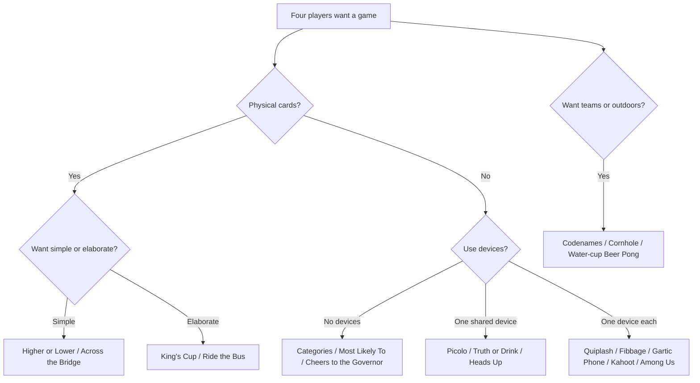
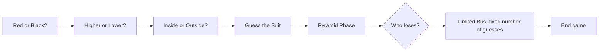

# Drinking Games for Four Players: A Comprehensive, Categorized Research Guide

## Executive Summary

For **exactly four people**, the strongest drinking-game formats are those that keep all four participants engaged without creating long waits or concentrating penalties on one person. Across the categories researched, the best-balanced choices are **Categories, Most Likely To, Never Have I Ever, Higher or Lower, King’s Cup with modified penalties, Truth or Drink, Picolo, Quiplash, Fibbage, Gartic Phone, Codenames, and cornhole**. Several of these are established drinking games; others are popular party or tabletop games that accept a simple drinking-rule overlay. Four players are explicitly within the supported or recommended range for many of them, including Most Likely To, Cheers to the Governor, Fuzzy Duck, Thumper, Paranoia, Quiplash, Fibbage, Among Us, Codenames, and UNO. citeturn2search4turn2search1turn3search4turn3search7turn3search5turn5search2turn5search3turn10search0turn9search3turn12search2

The most important distinction is between **game quality** and **drinking intensity**. Some classic games—particularly traditional Medusa, King’s Cup, Ride the Bus, Irish Poker, Screw the Dealer, Horse Race, and uncapped random-prompt apps—can produce multiple penalties quickly. NIAAA specifically identifies *speed of drinking* as a factor in alcohol-overdose risk, and defines binge drinking for a typical adult as a pattern reaching approximately four standard drinks for women or five for men in about two hours; these are risk definitions, **not recommended targets or safe limits**. A U.S. standard drink contains about 14 g of pure alcohol, roughly the amount in 12 oz of 5% beer, 5 oz of 12% wine, or 1.5 oz of 40% spirits. citeturn6search0turn6search1turn6search2

Accordingly, throughout this report **“recommended penalty” means one small sip at most**, never a shot, chug, waterfall, communal-cup finish, or multiple consecutive sips. A sip is not a standardized quantity, so players should track actual beverages/standard drinks separately. Every drinking rule can instead be replaced by water, a nonalcoholic drink, points, tokens, or a harmless challenge. citeturn6search2turn6search3

For four players, the practical winners are:

| Goal | Best choices | Why |
|---|---|---|
| Almost zero setup | **Categories, Most Likely To, Never Have I Ever** | Immediate play; four is an excellent group size. citeturn3search0turn2search4turn2search5 |
| Simple card game | **Higher or Lower, Across the Bridge** | One ordinary deck; rules teach in under a minute or two. citeturn4search4turn4search2 |
| Classic drinking-game atmosphere | **King’s Cup** | High variety, many mini-games, ideal around a table; use the low-intensity substitutions below. citeturn1search0turn1search2 |
| One shared phone | **Picolo, Truth or Drink, Pass the Phone** | Designed around one device or a device passed around the group. citeturn0search0turn0search6turn0search5 |
| Four phones + host screen | **Quiplash, Fibbage** | Four falls comfortably within their official player counts; roughly 15-minute sessions. citeturn5search2turn5search3 |
| Four individual browsers | **Gartic Phone** | Drawing/telephone structure works particularly well at four. citeturn11search0turn11search1 |
| Strategy/team game | **Codenames** | Officially 4–8+ players and about 15 minutes; four gives a natural 2v2 structure. citeturn9search3 |
| Outdoor/team play | **Cornhole or water-cup beer pong** | Natural 2v2 formats; official competitive beer pong actually uses water in the cups. citeturn7search0turn7search3 |

## Safety and Risk Framework

The **intoxication-risk ratings below are comparative, not medical predictions**. They describe how readily the game mechanics can generate alcohol penalties if played in their conventional form.

**Low** means penalties are infrequent or can naturally be restricted to round boundaries. **Moderate** means one player may encounter repeated drinking triggers over a session. **High** means the traditional rules commonly include shots, chugging, escalating quantities, cumulative bets, repeated failures, or several penalties in quick succession. The recommended variants in this report deliberately reduce many High games to a lower practical intensity.

NIAAA notes that alcohol overdose can suppress breathing, heart rate, temperature regulation, and other life-support functions. Warning signs include inability to remain conscious or wake up, vomiting, seizures, slow or irregular breathing, clammy or pale/bluish skin, and very low body temperature. A suspected overdose warrants immediate emergency assistance; an unconscious intoxicated person should not simply be left to “sleep it off.” citeturn6search0turn6search5 Alcohol combined with opioids, benzodiazepines, sleep medications, or other sedating drugs can increase overdose danger. citeturn6search0

Driving should be separated completely from game participation: CDC states that alcohol impairs capabilities needed for safe driving even below common legal BAC thresholds. citeturn6search6

A useful house policy for **every game below** is:

> **One-trigger rule:** one game event can cost at most one small sip. No stacking, doubling, “finish your drink,” forced consumption, shots, or penalties for refusing alcohol. A player can always substitute water, a nonalcoholic beverage, points, or simply pass.

This particularly improves games whose folk rules traditionally use “two drinks,” “four drinks,” doubles, shots, or waterfalls. The point is to preserve the game mechanic—memory, guessing, bluffing, timing, embarrassment, trivia—without making alcohol volume the competition.

## At-a-Glance Comparison

**Complexity** measures rules overhead, not difficulty winning. **Risk** reflects the traditional/default drinking implementation where one exists; for ordinary games adapted here, it reflects the suggested drinking overlay. Duration figures are estimates for a four-person casual session unless an official source gives a duration.

| Game | Category | Complexity | Main equipment | Four players? | Approx. duration | Intoxication risk |
|---|---|---:|---|---|---:|---|
| Never Have I Ever | No device | Low | Nothing | **Yes**; 4–10 works well. citeturn2search5 | 15–30 min | Moderate |
| Most Likely To | No device | Low | Prompt ideas optional | **Yes**; 4–10 especially suitable. citeturn2search4 | 10–20 min | Moderate |
| Categories | No device | Low | Nothing | **Yes**; 4–10 recommended. citeturn3search0 | 10–20 min | Moderate |
| Cheers to the Governor | No device | Medium | Nothing | **Yes**; 4–10 works best. citeturn2search1 | 15–30 min | Moderate–High |
| Fuzzy Duck | No device | Medium | Nothing | **Yes**; source gives 4–12. citeturn3search4 | 10–20 min | Moderate |
| Thumper | No device | Medium | Table | **Yes**; 4–12. citeturn3search7 | 10–20 min | Moderate |
| Paranoia | No device | Low | Nothing | **Yes**; 4+ explicitly. citeturn3search5 | 15–25 min | Moderate |
| Medusa | No device | Low | Clear sightlines | **Yes**, although often better with more. citeturn2search3 | 5–15 min | **High traditionally** |
| King’s Cup | Standard deck | Medium | 52 cards + central cup | **Yes**; commonly 3–10. citeturn1search2 | 30–60 min | **High traditionally** |
| Ride the Bus | Standard deck | High | 52 cards | **Yes**; 3+ supported. citeturn1search4 | 25–45 min | **High traditionally** |
| Irish Poker | Standard deck | Medium | 52 cards | **Yes**; normally 3–8. citeturn4search0 | 15–30 min | **High traditionally** |
| Across the Bridge | Standard deck | Low | 52 cards | **Yes**; 2+ works. citeturn4search2 | 15–25 min | Moderate–High |
| Higher or Lower | Standard deck | Low | 52 cards | **Yes**. citeturn4search4 | 10–20 min | Moderate |
| Screw the Dealer | Standard deck | Medium | 52 cards | **Yes**. citeturn4search5 | 20–40 min | **High traditionally** |
| Horse Race | Standard deck | Medium | 52 cards | **Yes**. citeturn4search3turn4search4 | 10–15 min/race | **High if drink-betting** |
| Picolo | Shared device | Low | One phone | **Yes**; names are entered for a group. citeturn0search0turn0search1 | 15–30 min | Moderate–High |
| Truth or Drink | Shared device | Low | One browser/phone | **Yes**; physical edition supports 2+. citeturn0search6turn0search7 | 20–40 min | Moderate |
| Drunk Pirate | Shared device | Low | One browser | **Yes**; commonly listed for 2–20. citeturn0search8turn0search9 | ~30 min | High uncapped |
| Pass the Phone | Shared device | Low | One phone | **Yes**; official listing says 3–8. citeturn0search4turn0search5 | 10–25 min | Low–Moderate |
| Heads Up! | Shared device | Low | One phone | **Yes**. citeturn8search0 | 10–20 min | Low |
| Quiplash | Multi-device | Low | Host screen + phone each | **Yes**; 3–8, ~15 min. citeturn5search3 | ~15 min | Low–Moderate |
| Fibbage 2 | Multi-device | Low | Host screen + phone each | **Yes**; 2–8, ~15 min. citeturn5search2 | ~15 min | Low–Moderate |
| Gartic Phone | Multi-device | Low | Browser/device each | **Yes**; four is supported/recommended. citeturn11search0turn11search4 | 15–25 min | Low |
| Kahoot! | Multi-device | Low | Host + browser/app each | **Yes**; join using PIN/link/QR. citeturn5search5 | 15–30 min | Low–Moderate |
| Among Us | Multi-device | Medium | Game/device each | **Yes—four is the official minimum.** citeturn10search0turn10search7 | 10–20 min/match | Low–Moderate |
| Water-cup Beer Pong | Team/outdoor | Medium | Table, cups, balls | **Yes: 2v2**; official BPONG uses water. citeturn7search0 | 15–30 min | Moderate with overlay |
| Cornhole | Outdoor/team | Low | Boards + 8 bags | **Yes: official doubles = 2v2.** citeturn7search3 | 20–40 min | Low |
| Codenames | Team/trivia | Medium | Codenames set | **Yes**; official range 4–8+. citeturn9search3 | ~15 min official | Low–Moderate |
| UNO drinking adaptation | Adapted card game | Low | UNO deck | **Yes**; official range 2–10. citeturn12search2 | 20–40 min | Moderate |
| Jenga drinking adaptation | Adapted dexterity | Low | Jenga tower | **Yes**; official game supports 1+. citeturn9search2 | 15–30 min | Moderate |

## In-Person No-Device Games

These are the easiest choices for a spontaneous four-person gathering. Aside from drinks and, for Thumper, a table, they require no dedicated equipment.

| Game | Setup and concise rules | Typical penalty and safer four-player version | Variations | Duration / safety |
|---|---|---|---|---|
| **Never Have I Ever** | Sit in a circle. In turn say something truthful beginning “Never have I ever…”. Anyone who *has* done it responds. The common Ten Fingers version starts everyone with ten fingers and lowers one instead of—or in addition to—drinking. Four players is squarely in the recommended 4–10 range. citeturn2search0turn2search5 | Traditional drinking form: anyone who has done the thing takes a sip. **Recommended:** one sip maximum per statement, or simply lower a finger. | Ten Fingers; themed questions; first to five fingers; completely nonalcoholic points version. | **15–30 min. Moderate.** Avoid deliberately exposing trauma, sexual history, medical information, or other information someone does not want to discuss; anyone can decline a prompt without penalty. |
| **Most Likely To** | Read “Who is most likely to…?” On a count of three everyone points simultaneously. The person receiving the most votes wins that prompt. Four is described as part of its ideal 4–10 range. citeturn2search2turn2search4 | Drinking variants usually have the most-voted player sip. **Recommended:** only one sip even if all three others point at that person. | Track points; themed prompts; minority-vote version; winner performs a harmless dare rather than drinking. | **10–20 min. Moderate.** Ban insulting, discriminatory, sexual-pressure, or relationship-damaging prompts beforehand. |
| **Categories** | One player names a category, e.g. “countries.” Go clockwise giving unique valid answers. Repetition, an invalid answer, or excessive hesitation loses the round; the loser chooses the next category. It is specifically described as working especially well with 4–10. citeturn3search0turn3search1 | Typical: loser sips. **Recommended:** one sip per lost category, never additional penalties for repeated failures. | Three-second timer; alphabetical answers; answers must follow a beat; themed categories. | **10–20 min. Moderate.** One of the better low-volume options because a penalty normally occurs only at the end of a word chain. |
| **Cheers to the Governor** | Count around the table from 1 to 21. A mistake resets the count. Reaching 21 permits a player to replace one number with a new verbal or physical rule; rules accumulate and the sequence becomes progressively harder. Four to ten is identified as the best range. citeturn2search1 | Conventional rules penalize errors and sometimes also reaching 21. **Recommended:** errors = one sip; reaching 21 = no mandatory alcohol. | Reverse direction on a number; clap rather than say a number; word substitution; category rule. | **15–30 min. Moderate–High traditionally.** As rules accumulate, errors become frequent; stop adding alcohol penalties after a player has failed once in a round. |
| **Fuzzy Duck** | Players pass “fuzzy duck” around the circle. Instead of continuing, a player can say “does he?” to reverse direction, whereupon the phrase becomes “ducky fuzz”; another reversal changes it back. Hesitating or saying the wrong phrase loses. A current rules source lists 4–12 players. citeturn3search2turn3search4 | Typical: one drink/sip for a mistake. **Recommended:** one small sip; restart immediately. | Speed rounds; two-second response timer; alternate reversal phrase. | **10–20 min. Moderate.** Do not convert pronunciation errors into accumulating or doubled penalties. |
| **Thumper** | Each player invents a unique hand sign. Everyone drums on the table; the active player performs their own sign and then someone else’s. That player must notice and pass play onward with their own sign plus another sign. Missing the call or rhythm loses the round. Rules sources give four as the minimum or within the normal range. citeturn3search7turn3search8 | Typical: loser drinks. **Recommended:** one sip between rounds only. | Faster beat; thematic gestures; eliminate the introductory chant; teams of two. | **10–20 min. Moderate.** A good four-person reaction game because everyone watches continuously. |
| **Paranoia** | Player A whispers a “who in this group…?” question to Player B. B answers by naming/pointing at someone. The named person can choose whether to discover the question. The published rules explicitly list **4+ players**. citeturn3search5turn3search6 | Traditional variants make revealing the question cost alcohol. **Recommended:** reveal by spending a token; if retaining a drink rule, one sip maximum. | Clean questions only; anonymous question cards; every question revealed automatically. | **15–25 min. Moderate alcohol risk, potentially high social risk.** Let anyone veto a question or refuse to name somebody without consequence. |
| **Medusa** | Everyone looks down; on a count, each looks at one other person. If two players look directly at each other, that mutual pair loses the round. With four random players, each person has three possible targets. citeturn2search3 | Traditional rules frequently specify **shots**, making this one of the highest-intensity classics. **Do not use shots.** Substitute one small sip per matched pair, or a point. | First to three points; matched pair sits out one round; teams. | **5–15 min. High traditionally.** Predetermine a finite number of rounds; its extremely short round cycle makes unrestricted drinking particularly unsuitable. citeturn2search3turn6search0 |

For four specifically, **Categories** is arguably the cleanest no-device design: there is only one loser per word chain, nobody sits out, and the game remains challenging without a large circle. **Most Likely To** and **Never Have I Ever** work better when the goal is conversation rather than competition. **Cheers to the Governor** and **Thumper** provide the strongest memory/reaction component.

## Standard-Deck Card Games

Every game in this section uses an ordinary **52-card deck** unless stated otherwise. Folk drinking games rarely have a single authoritative publisher, so rules genuinely vary by region and group; where multiple sources differ, the version below emphasizes the most common structural elements rather than claiming one canonical rule set. PlayingCardDecks, for example, catalogs King’s Cup, Pyramid/Ride the Bus, and Across the Bridge, while other specialist rules sites document substantial house-rule variation. citeturn1search0turn4search4

| Game | Setup and four-player rules | Typical drinking rule → recommended modification | Variations | Duration / risk |
|---|---|---|---|---|
| **King’s Cup / Kings / Ring of Fire** | Shuffle the deck and spread cards face-down around a central cup. Players draw clockwise; each rank triggers a mini-rule. A common map is **A = waterfall; 2 = choose someone; 3 = drawer; 4 = floor; 7 = heaven; 8 = mate; 9 = rhyme; 10 = categories; J = Never Have I Ever; Q = question chain; K = rule/cup**, while 5 and 6 vary heavily between groups. Rules sources commonly place it at roughly 3–10 players, so four works well. citeturn1search0turn1search2 | Traditional versions can include continuous drinking and a fourth-King communal cup. **Recommended:** convert every drinking result to one sip; make Ace a non-drinking reaction challenge; make the fourth King one sip or a point—not a communal mixture. | Replace gender-based 5/6 rules with “thumb master,” “make a rule,” trivia, or charades; use only half the deck for a shorter session. | **30–60 min. High traditional risk.** One of the games most improved by replacing waterfall and cup-finishing mechanics. |
| **Ride the Bus** | Phase one: every player receives/reveals four cards while guessing **red/black**, then **higher/lower**, then **inside/outside**, then **suit**. Phase two uses a card pyramid in which matching ranks interact with revealed cards. One player eventually “rides the bus,” typically making repeated card guesses until completing the required sequence. citeturn1search1turn1search4turn1search5 | Traditional penalties escalate across the four guesses and can compound severely during the bus. **Recommended:** every incorrect guess is one sip *maximum*, and riding the bus has a fixed attempt limit rather than restarting indefinitely. | Skip the final bus; pyramid only; use points during qualification and one sip only for losing the overall game. | **25–45 min. High traditional risk.** The restart mechanic is the main risk amplifier. |
| **Irish Poker** | Deal four face-down cards to every player. Before revealing each, predict in sequence: color, higher/lower than card one, inside/outside the first two, and exact suit. Common versions then add a give/take or bus-style phase. Four is comfortably inside the commonly stated 3–8-player range. citeturn4search0turn4search1 | Traditional rules often scale penalties from one through four units and may let correct guessers assign those amounts. **Recommended:** correct = one point; wrong = one sip regardless of round number. | End after four guesses; play several hands for points; no “give drinks” mechanic. | **15–30 min. High traditionally, moderate with cap.** |
| **Across the Bridge** | Lay ten cards face-down in a row. Flip from one end. Number cards are safe; a Jack, Queen, King, or Ace ends or interrupts the turn and extends the bridge by an associated number of new cards. Published versions commonly assign larger penalties to progressively higher face cards. citeturn4search2turn1search0 | Traditional: J/Q/K/A may cost escalating amounts. **Recommended:** any face card or Ace costs exactly one sip, regardless of rank. | Individual bridges; cooperative bridge; points for distance crossed. | **15–25 min. Moderate–High traditionally.** Particularly easy to make safer because rank values need not equal drink quantity. |
| **Higher or Lower** | Flip a starting card. The next player predicts whether the next card is higher or lower; reveal it and pass play. Agree before starting whether ties lose and whether Ace is high or low. citeturn4search4 | Typical: wrong guess = sip. **Recommended:** exactly that—one sip maximum—and then advance to the next player; never make a player keep guessing until correct. | Red/black warm-up; three-correct-to-win; keep score rather than drink. | **10–20 min. Moderate.** Probably the simplest standard-deck choice for four. |
| **Screw the Dealer** | Dealer secretly views the card/rank. Next player guesses its value. After a wrong first guess the dealer honestly says higher/lower; the guesser gets another try. Revealed cards remain visible, creating memory/card-counting information. Common versions pass the deal after the dealer defeats several players consecutively. citeturn4search5turn4youtube7 | Conventional versions can penalize by the numerical distance between guess and card and can give the dealer several drinks on a correct guess. **Recommended:** any losing outcome = one sip only; never convert numerical difference into drink count. | Pass dealer after three turns regardless; scoring-only; use only ranks 2–10 to shorten. | **20–40 min. High traditionally.** Difference-based penalties are the main escalation mechanism. |
| **Horse Race** | Remove the four Aces and line them up as “horses,” one per suit. Flip cards from the deck; a suit’s Ace advances whenever that suit appears. Some versions add face-down “track” cards that can move horses backward. Each player picks a horse/suit. citeturn4search3turn4search4 | Traditional play often has players wager drinks, sometimes with enhanced penalties for losing bets. **Recommended:** bet **points or tokens**, then have losing players take at most one sip when the race ends. | Two players may back the same horse; best-of-three races; auction horses for points. | **10–15 min/race. High if drink-betting is uncapped; low–moderate with tokens.** |

### King’s Cup rule map for a four-player table

Because King’s Cup is the most rule-dense card game here, this modified mapping preserves its variety without its highest-risk mechanics:

| Card | Four-player rule |
|---|---|
| Ace | Everyone raises a hand; last person takes **one sip**—no waterfall |
| 2 | Choose someone to answer a trivia question; wrong = one sip |
| 3 | Drawer takes one sip |
| 4 | Last to touch the floor takes one sip |
| 5 | Thumb master |
| 6 | Make a harmless table rule |
| 7 | Last hand raised takes one sip |
| 8 | Choose a “mate”; next penalty is shared as half/nonalcoholic or one person can opt out |
| 9 | Rhyming chain; first mistake one sip |
| 10 | Categories |
| Jack | Never Have I Ever, one statement |
| Queen | Questions-only chain |
| King | Add a house rule; fourth King **does not require finishing a cup** |

The underlying King’s Cup convention—drawing clockwise and attaching an action to each rank—is well established, but precise rank meanings vary substantially. citeturn1search0turn1search2turn1search3

A safer Ride-the-Bus structure is similarly straightforward:

Treat every incorrect node as **no more than one sip**, rather than letting later stages multiply consumption.

## Shared-Device Games

This category assumes **one phone, tablet, or laptop visible to—or physically passed among—all four players**.

| Game | Setup and rules | Four-player drinking adaptation | Variations | Duration / safety |
|---|---|---|---|---|
| **[Picolo](https://www.picoloapp.com/)** | Enter player names on one phone and follow the displayed questions, challenges, or group instructions. Picolo’s official description presents it as a one-phone party/drinking game with different modes and group-oriented prompts. citeturn0search0turn0search1 | Where Picolo requests multiple drinks, finishing a beverage, or a drinking task, replace it with **one sip maximum** or a non-drinking challenge. | Different prompt packs/modes; teams; everyone gets one free veto each round. | **15–30 min. Moderate–High depending on pack.** Picolo's terms itself frames alcohol use as limited to people legally permitted to drink and calls for responsible use. citeturn0search10 |
| **[Truth or Drink](https://truthordrink.com/)** | A question is presented; the selected player either answers honestly or declines. The official online version supplies categories such as Normal, Party, Spicy, and Dares; the licensed physical game is officially described as suitable for 2+ players, confirming four works easily. citeturn0search6turn0search7 | Standard mechanism: answer or sip. Keep the decline cost at **one sip maximum**, and permit a no-cost veto for genuinely sensitive questions. | Everyone answers; secret answers; couples/friends deck; nonalcoholic version. | **20–40 min. Moderate.** Hasbro explicitly notes that alcohol is not required to play the physical version. citeturn0search7 |
| **[Drunk Pirate](https://drunkpirate.co.uk/)** | Open the browser game on a laptop or phone; players take turns following the randomized cards/prompts displayed. The official site supplies the game itself; secondary rules listings describe the core as “do what the card says” and commonly place sessions around 30 minutes. citeturn0search8turn0search9 | Treat any alcohol instruction, regardless of wording or number, as **one optional sip maximum**. Never let the web prompt override the group’s pre-agreed cap. | Skip card freely; family-safe/non-drinking substitutes; two teams. | **20–30 min. High uncapped, moderate with a strict cap.** |
| **[Pass the Phone](https://passthephone.app/en/pass-the-phone-game/)** | One phone circulates through the group. A player reads a prompt, selects the person it best fits, then passes the phone onward. The current official version advertises 3–8 players, 300+ prompts, offline operation, and no required account, making four an exact fit. citeturn0search4turn0search5 | Because it is not inherently a drinking game, use a **slow overlay**: after five prompts, whichever player was selected most often may take one sip—not one sip for every selection. | Different prompt modes; no alcohol; winner/loser tally; one “skip me” token each. | **10–25 min. Low–Moderate.** |
| **[Heads Up!](https://play.google.com/store/apps/details?id=com.wb.headsup)** | One player holds the phone to their forehead while the other three give clues to the displayed word. Correct guesses advance; skipped words are passed. The official app describes 60-second guessing rounds and passing the same device between players. citeturn8search0turn8search1 | After each 60-second turn, **zero correct = one sip**; otherwise no penalty. Alternatively, split 2v2 and only the team losing a complete match sips. | Teams; custom categories; acting-only; songs/movies/celebrities. | **10–20 min. Low.** This is one of the safest ways to add a drinking element because penalties can occur only once per minute-long turn. |

For a group that actually wants **conversation**, Truth or Drink is strongest. For minimal thinking, Picolo or Drunk Pirate functions like an automated game-master. For a game in which alcohol is almost incidental, Heads Up is considerably better balanced.

## Multi-Device Networked Games

These use **one device per participant**, normally with a room code, lobby, server, invite link, or local/online multiplayer session. Jackbox additionally needs a visible host display. Four is enough for all five recommendations.

| Game | Setup and official game loop | Suggested four-player drinking rule | Variations | Duration / safety |
|---|---|---|---|---|
| **Quiplash** | One person launches the Jackbox game on a shared screen; everyone visits Jackbox.tv on their own device and enters the displayed room code. Players write funny answers to prompts and then vote head-to-head. Officially **3–8 players** and about **15 minutes**. citeturn5search0turn5search3 | Losing a head-to-head = **one sip at most**; a player can incur only one alcohol penalty per game round regardless of how many matchups they lose. | 2v2 cumulative score; audience mode; family-friendly setting. | **~15 min. Low–Moderate.** Four is an excellent count because everyone both writes and votes frequently. |
| **Fibbage 2** | Host on shared display; phones act as controllers through Jackbox.tv. The game gives an obscure fact with a missing answer; players invent convincing lies, then everyone tries to choose the real answer. Officially **2–8 players** and about **15 minutes**. citeturn5search0turn5search2 | If you choose another player’s lie, one sip; **cap at one sip per question**. Alternatively only last place after the whole game sips. | Teams; deFIBrillator; no-drink point scoring. | **~15 min. Low–Moderate.** Last-place-only is the lower-risk version. |
| **[Gartic Phone](https://garticphone.com/)** | Host creates a browser room and shares the invite. Everyone writes a sentence, receives someone else’s sentence to draw, then describes someone else’s drawing, alternating until the chains are revealed. That write/draw/describe/reveal structure is official. Four is a supported lobby size and is commonly recommended as the minimum for the telephone effect to become interesting. citeturn11search0turn11search1turn11search4 | During the final reveal, the group votes for the biggest semantic derailment; its author may take **one sip for the entire chain**, not every mistake. | Normal, Knock-Off, Animation, Icebreaker, Story, Secret, Co-op and other modes are available in the web lobby. citeturn11search6 | **15–25 min. Low.** Drawing—not alcohol—remains the center of the game. |
| **[Kahoot!](https://kahoot.it/)** | Host a quiz; each player joins via game PIN, direct link, or QR code from a browser/app. Accounts are generally not required merely to join, though host settings can change identification/security steps. citeturn5search5 | Avoid “drink for every wrong answer,” which can trigger repeatedly. Instead, after **every three questions**, the current fourth-place player may take one sip; no more than one per three-question block. | Custom friend trivia; music intros; “who knows the group best?”; themed pub quiz. | **15–30 min. Low–Moderate with block scoring.** |
| **[Among Us](https://www.innersloth.com/games/among-us/)** | Each player uses their own device. Crewmates complete tasks and identify the Impostor; Impostors sabotage and eliminate crew. Innersloth officially supports **4–15 players** online/local Wi-Fi, and recent game logic prevents a match from starting below four—so four is exactly the minimum. citeturn10search0turn10search7 | Use **between-match penalties only**: losing faction takes one sip after the match. Do not drink on each death, accusation, task failure, or vote. | Rotate one Impostor; short tasks; Hide n Seek; best of three. | **10–20 min/match. Low–Moderate.** Drinking during active play would unnecessarily impair a game built around deception, reaction and observation. |

Jackbox is especially well suited to four because the official platform explicitly treats phones as controllers and uses room codes, meaning there is no need to buy four copies of the game; one host owns/runs it. citeturn5search0turn5search7

For pure entertainment value rather than alcohol throughput, **Quiplash, Fibbage, and Gartic Phone are among the strongest options in the entire report**: their underlying games already generate competition and comedy, so the drinking rule can remain sparse.

## Outdoor, Team, Trivia, and Adapted Games

This category covers games that are not inherently drinking games but become good four-person party formats with modest rules layered on top.

| Game | Setup and core rules | Drinking adaptation for four | Variations | Duration / safety |
|---|---|---|---|---|
| **Water-cup Beer Pong, 2v2** | Ten cups per side in triangular formation; one shot per team member on most turns. Importantly, the **official World Series of Beer Pong rules fill the target cups with water and explicitly state that the water is not for consumption and nobody is required or encouraged to drink because of game outcomes**. citeturn7search0turn7search1 | Follow official water-cup sanitation practice. Keep personal beverages separate. When the opposing team sinks one or more balls in a turn, the defending team takes **at most one small sip total**, not one per cup. | Six-cup shorter game; bounce rules; redemption; nonalcoholic version identical to tournament play. | **15–30 min. Moderate with overlay.** Never drink liquid from cups into which repeatedly handled ping-pong balls have landed. |
| **Cornhole, 2v2** | Two teams of two. Players at opposite boards alternate pitching bags; standard competitive play uses four bags and cancellation scoring, usually aiming for 21. The American Cornhole Organization explicitly defines doubles as two-person teams. citeturn7search3turn7search8 | At the **end of a completed game**, each member of the losing team takes one sip. No alcohol penalty per bag or point. | Best of three; closest game; handicaps for mismatched ability. | **20–40 min. Low.** The once-per-game penalty makes this one of the lowest-intensity outdoor choices. |
| **Codenames, 2v2** | Split into two teams. Each team has a spymaster who gives a one-word clue plus number; their teammate guesses matching words. Wrong guesses can end the turn; selecting the assassin loses immediately. Official Codenames supports **4–8+ players** and lists a length around **15 minutes**. citeturn9search3turn9search7 | Wrong guess = no automatic drink; **losing team takes one sip each when the game ends**. Or assassin selection alone triggers one sip each. | Swap spymasters after every game; best of three; Codenames Pictures. | **~15 min/game. Low.** Excellent if the group wants a genuine strategy game rather than a drinking mechanism. |
| **UNO drinking adaptation** | Deal and play normal UNO: match the current discard by color, number, or compatible action; otherwise draw. Skip, Reverse, Draw Two, Wild and Draw Four alter play; first to empty their hand wins. Mattel officially lists classic UNO for **2–10 players**, so four is central to the intended range. citeturn12search1turn12search2 | Simple version: **drawing because you cannot play = one sip maximum for that turn**; being hit with Draw Two/Four does **not** multiply alcohol. Round loser may instead take a single sip and remove all mid-round drinking. | Teams; cumulative points; blank Wild house rules. | **20–40 min. Moderate if every draw triggers; low if only round loser drinks.** |
| **Jenga drinking adaptation** | Build the 54-block tower. In turn remove one block and place it on top; the player who causes the tower to collapse loses. Hasbro’s official description supports one or more players, so four is straightforward. citeturn9search1turn9search2 | Write or attach **mostly non-drinking** prompts to selected blocks: trivia, reverse turn order, compliment another player, categories, etc. Tower collapse = one sip. | Number blocks and use a separate rule sheet so the set is not permanently marked; team Jenga; truth/dare blocks. | **15–30 min. Moderate depending on prompts.** Avoid instructions such as shots, chugging, mixing beverages, or repeated targeted penalties. |

### Trivia and long-form adaptations

Almost any trivia, board, sports-viewing, or video-game session can become a low-intensity drinking game if the alcohol trigger is tied to **large structural events rather than frequent micro-events**. For example, in a four-player trivia game, only the player in last place after a full round takes one sip; in a sports watch party, one agreed rare event might trigger one sip, with a fixed total cap. This is preferable to attaching alcohol to every wrong answer, possession change, foul, death, score, card draw, or other frequent event because drinking speed itself contributes to overdose risk. citeturn6search0

### Why “endurance” drinking games are not recommended

I have **not included Power Hour-style games, Centurion, chug races, drinking relays, or other endurance formats as playable recommendations**. Their core challenge is generally to consume alcohol repeatedly or rapidly rather than to perform an independent social, strategic, dexterity, or trivia task. NIAAA specifically warns that consuming too much alcohol too quickly can cause dangerous impairment and alcohol overdose, and that blood alcohol concentration can continue rising even after drinking has stopped. citeturn6search0

The useful part of an endurance concept can be preserved without alcohol: use **hour-long trivia**, a tournament bracket, best-of-five Codenames, rotating Jackbox games, multiple Horse Races scored with points, or a long movie/sports challenge where alcohol penalties occur only at widely spaced checkpoints. This retains the “long session” aspect without making consumption speed or quantity the objective.

### Overall recommendations for exactly four

For a four-person group seeking the best combination of **fun, low setup burden, and controllable drinking intensity**, I would rank the formats qualitatively as follows:

**Best overall: Categories.** Four gives enough answer variety to make categories difficult while keeping turns extremely fast; only the failed player needs a penalty at the end of a chain. The game is explicitly recommended for groups beginning at four. citeturn3search0

**Best classic card game: King’s Cup, heavily modified.** It offers more mechanical variety than almost anything else—a deck becomes a sequence of reaction games, word games, personal prompts, and house rules—but traditional waterfall and King’s-cup mechanics should be replaced with single-sip or nonalcoholic equivalents. citeturn1search0turn1search2

**Best simple card game: Higher or Lower.** It is almost impossible to forget the rules, requires only a deck, and naturally rotates among four players. citeturn4search4

**Best shared-phone game: Truth or Drink for conversation; Picolo for chaos.** Truth or Drink has one clear choice—answer or decline—while Picolo acts as an automated party-game host with much more varied challenges. citeturn0search0turn0search6turn0search7

**Best multi-device option: Quiplash or Fibbage.** Both officially accommodate four and run around 15 minutes, use individual phones as private controllers, and already have a complete scoring system; this makes alcohol entirely optional rather than necessary to generate stakes. citeturn5search0turn5search2turn5search3

**Best free browser-style multiplayer option: Gartic Phone.** Four provides enough links in each write/draw/describe chain to produce the intended telephone distortion without waiting through a large lobby. citeturn11search0turn11search1

**Best competitive team option: Codenames.** Four is the official minimum for the standard team game, naturally producing two teams of two, with an official expected duration of roughly 15 minutes. citeturn9search3

**Best outdoor format: Cornhole.** Official doubles is exactly four players, and because scoring already creates competition there is no need for frequent drinking penalties; one optional end-of-game sip is enough. citeturn7search3

**Best “beer pong” format: actual tournament-style water cups with separate drinks.** Contrary to the popular image of the game, the World Series of Beer Pong’s official rules use water in the target cups and state that participants are not required or encouraged to consume alcohol because of gameplay. That makes it easy to add a controlled, separate one-sip-per-turn-maximum house rule without requiring anyone to consume cup contents. citeturn7search0turn7search2

The strongest general design principle is therefore **“play a good game first; make drinking secondary.”** Four players are few enough that everyone gets many turns, so penalty frequency can rise much faster than it does in a group of eight or ten. Using round-level rather than event-level penalties, limiting any trigger to one small sip, making every alcohol rule optional, and tracking actual standard drinks preserves the social game while avoiding the mechanics most associated with rapid consumption. NIAAA emphasizes that both the amount and speed of drinking matter, while CDC notes that alcohol-related impairment can occur before a person reaches common legal driving thresholds. citeturn6search0turn6search2turn6search6